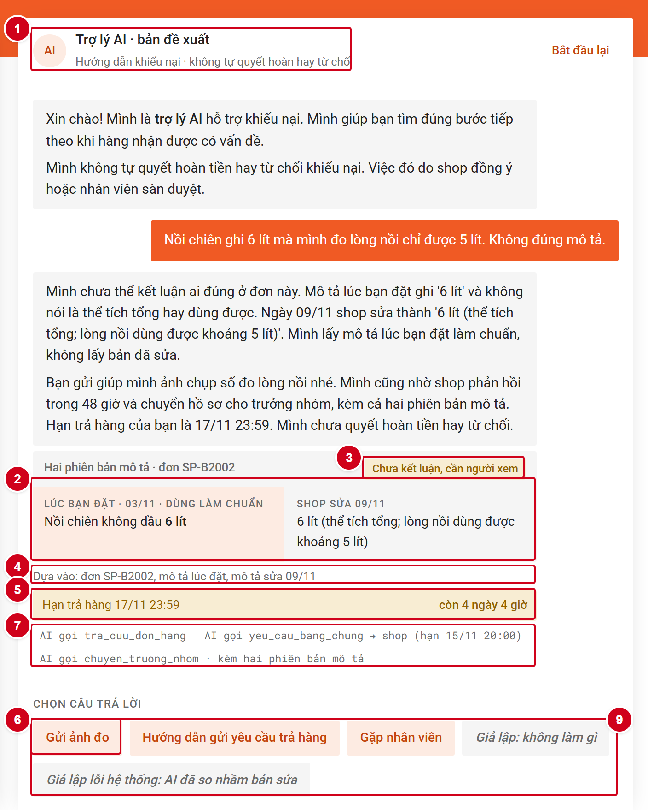
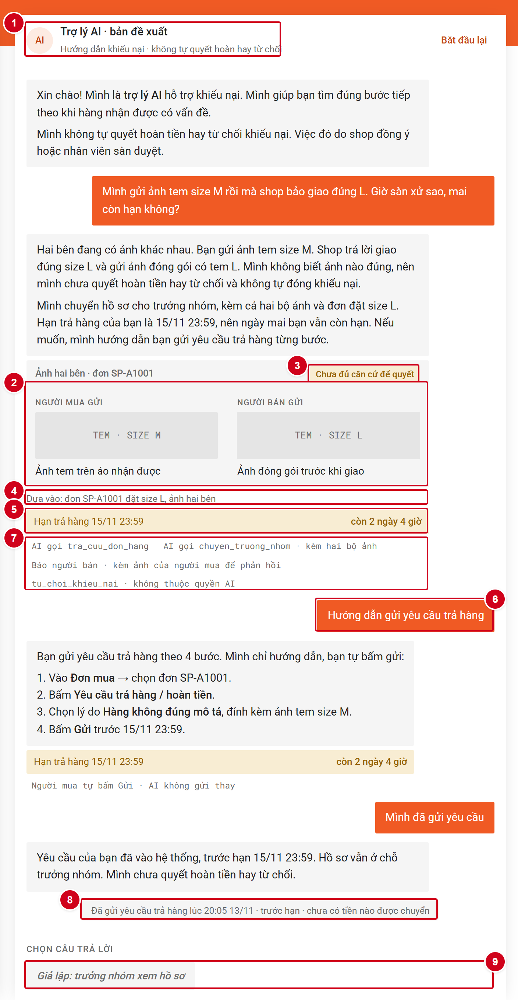

# Prototype — T4 Trò chuyện với Shopee · Nhóm PhiThuong

## Thông tin chung

- **Link bấm được:** https://claude.ai/artifact/HQrwkKMcZj935SxnYWLA6v
- **File trong repo:** [`index.html`](index.html). Mở bằng trình duyệt, không cần cài đặt.
- **Công cụ:** HTML, CSS, JavaScript thuần, dựng cùng coding agent (Claude).
- **Phần mock:**
  - Toàn bộ câu trả lời của AI là kịch bản soạn sẵn theo spec §3.
  - Dữ liệu đơn hàng là dữ liệu dựng theo spec §2.
  - Các nút "Giả lập: …" thay cho phản hồi của shop và quyết định của trưởng nhóm.
  - Không có backend, không đăng nhập.
- **Lời gọi AI thật:** không có.
- **Cách bấm:** người dùng chỉ chọn câu trả lời, không gõ chữ. Nút "Giả lập" có nền xám, chữ nghiêng, để phân biệt với nút người mua thật sự bấm.

## Ca khó được demo

Hai lựa chọn đầu tiên trong khung chat là hai kịch bản đắt nhất ở spec §2–§3.

### Ca #3 · Đơn B: nồi chiên "6 lít" đo được 5 lít

> "Nồi chiên ghi 6 lít mà mình đo lòng nồi chỉ được 5 lít. Không đúng mô tả."

1. AI trả lời đúng nguyên văn spec §3. Khung chat hiện:
   - thẻ hai phiên bản mô tả (lúc đặt 03/11 và bản shop sửa 09/11);
   - nhãn "Chưa kết luận, cần người xem";
   - dòng "Dựa vào";
   - hạn trả hàng 17/11 23:59.
2. Người mua chọn một trong các bước:
   - **Gửi ảnh đo**
   - **Hướng dẫn gửi yêu cầu trả hàng** (4 bước, người mua tự bấm Gửi)
   - **Gặp nhân viên**
3. Phía shop (giả lập), hạn phản hồi 15/11 20:00:
   - **Đồng ý hoàn:** shop bấm, hồ sơ đóng.
   - **Phản đối** hoặc **chưa trả lời trước hạn:** hồ sơ chờ trưởng nhóm. AI không tự hoàn.
4. Trưởng nhóm (giả lập) duyệt hoàn hoặc từ chối.
5. Nút **"Giả lập lỗi hệ thống: AI đã so nhầm bản sửa"** cho thấy cách AI xin lỗi khi đó là lỗi hệ thống.

### Ca #7 · Đơn A2: ảnh hai bên mâu thuẫn

> "Mình gửi ảnh tem size M rồi mà shop bảo giao đúng L. Giờ sàn xử sao, mai còn hạn không?"

1. AI trả lời đúng nguyên văn spec §3. Khung chat hiện:
   - hai ảnh cạnh nhau, "Người mua gửi" và "Người bán gửi";
   - nhãn "Chưa đủ căn cứ để quyết";
   - dòng "Dựa vào";
   - hạn trả hàng 15/11 23:59.
2. Người mua chọn một trong các bước:
   - **Hướng dẫn gửi yêu cầu trả hàng**
   - **Gặp nhân viên**
   - **"Vậy là bị từ chối rồi à?"**: AI giải thích "chưa đủ căn cứ" khác "từ chối".
3. Trưởng nhóm (giả lập) duyệt hoàn hoặc từ chối.
4. Nút **"Giả lập lỗi hệ thống: AI đã đóng khiếu nại"** cho thấy cách AI xin lỗi và chuyển gấp cho trưởng nhóm.

## Ảnh đánh số

**Ảnh 1 — ca #3, sau bước 1** (số 1–7, 9):

**Ảnh 2 — ca #7, sau khi người mua làm theo hướng dẫn và tự gửi yêu cầu trả hàng** (số 1–9):

| Số | Chỗ trên màn hình | Thể hiện gì | Nguyên tắc HAX/PAIR | Mức tự chủ |
|---|---|---|---|---|
| 1 | Tiêu đề khung chat: "Trợ lý AI · bản đề xuất", dòng "không tự quyết hoàn hay từ chối" | Người dùng biết đang nói chuyện với AI và AI không có quyền gì | G1, Luật AI 134/2025 Điều 11 | Cả hệ thống |
| 2 | Thẻ hai phiên bản mô tả (ca #3) / hai ảnh cạnh nhau (ca #7) | Căn cứ AI dựa vào, để người dùng tự kiểm | G11, PAIR Explainability + Trust | `tra_cuu_don_hang` tự làm |
| 3 | Nhãn vàng "Chưa kết luận, cần người xem" / "Chưa đủ căn cứ để quyết" | AI chắc tới đâu. Trạng thái này tách khỏi "từ chối" | G10, G2 | `tu_choi_khieu_nai` không thuộc quyền AI |
| 4 | Dòng "Dựa vào: …" | Nguồn dữ liệu của câu trả lời | G11 | — |
| 5 | Thanh hạn trả hàng và thời gian còn lại | Người mua biết còn bao lâu để tự gửi yêu cầu | G2 | — |
| 6 | Nút "Gửi ảnh đo" (ảnh 1) / "Hướng dẫn gửi yêu cầu trả hàng" người mua đã bấm (ảnh 2); luôn có "Gặp nhân viên" | Mỗi tình huống có một đường đi tiếp, luôn có đường chuyển người | PAIR Errors + Graceful Failure, G8 | `chuyen_truong_nhom` tự làm |
| 7 | Dòng chữ nhỏ dưới câu AI ("AI gọi …", "Trưởng nhóm bấm → …") | Hàm nào vừa chạy và ai là người bấm | — | Thể hiện mức của từng tool |
| 8 | Dòng hệ thống nền xám ("Đã gửi yêu cầu… · chưa có tiền nào được chuyển") | Trạng thái lấy từ hệ thống, không do AI tự nói | PAIR Errors | — |
| 9 | Không có nút hoàn hay từ chối ở phía người mua; chỉ có "Shop bấm" / "Trưởng nhóm bấm" | Quyết định tiền nằm ở người có thẩm quyền | — | `soan_hoan_tien`, `tu_choi_khieu_nai` cần duyệt; `phat_shop` cấm (không có nút) |

## Ghi chú

- Tên và giao diện đều ghi rõ đây là **bản đề xuất của nhóm**, không phải sản phẩm chính thức của Shopee.
- Khung chat còn các luồng phụ (ca nhiều lớp có xin OTP, đổi ý, nghi hàng giả). Chúng không thuộc hai ca chính ở trên.
